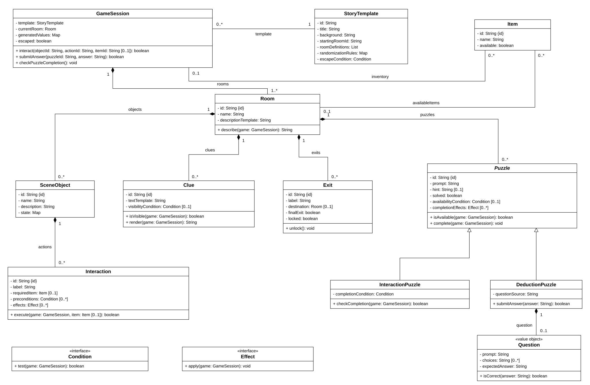
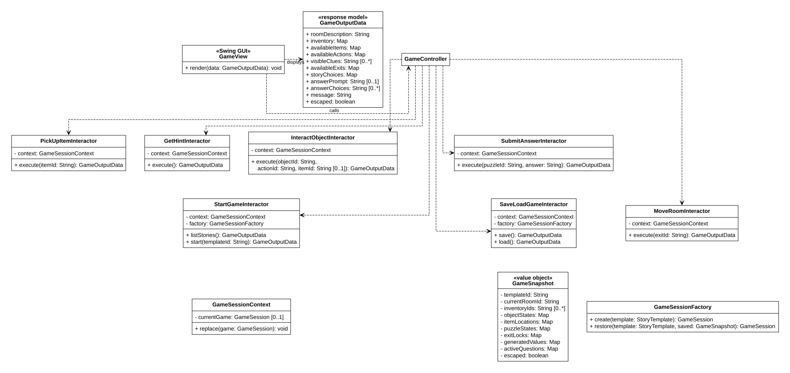
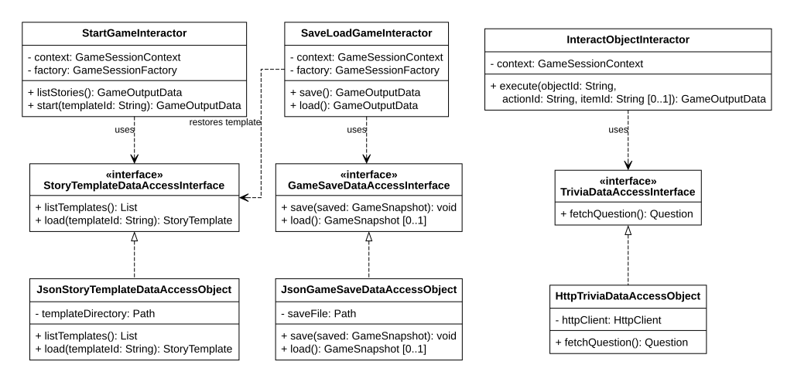

# Escape Room Adventure

## Team Information

### Team Members

- Zhiyu Li
- Wenqi Luo
- Yue Pan
- Jan Fung
- Bohan Zhang

---

## Project Description

### Domain

Escape Room Adventure is a text-based escape room game developed in Java with a Java Swing GUI. Players select a story template and explore its scenes by observing clues, interacting with the environment, collecting and using items, and solving puzzles to escape.

Each JSON story template defines the story background, room connections, scene objects, collectible items, clues, puzzles, hints, and escape conditions. The program supplies reusable movement, item collection, item use, state updates, and answer-checking logic. Templates configure how those features work in a particular story.

### Puzzle Types

| Puzzle Type | How the Player Solves It | Example |
|-------------|--------------------------|---------|
| Environmental interaction | Operate scene objects or use an inventory item to change the environment and reveal information or items. | Turn on a light to reveal writing; use a screwdriver to open a cover. |
| Observation and deduction | Read descriptions and clues, infer an answer, then enter a code or select an answer. | Combine the numbers on a wall with a note describing their color order to unlock a drawer. |

Both puzzle types can appear in the same room and form a sequence. Turning on a light can reveal the numbers needed for a separate code puzzle. Some question-based puzzles will obtain their questions from an external API.

### Player Interface and Session State

Swing displays room descriptions, visible clues, item and inventory lists, operation buttons, and answer input fields or choices. After an action, it updates the description, available items, actions, exits, and game status from the current session.

Some templates generate numbers or passwords at the start of a new game. The generated values are shared by the corresponding clues and expected answers throughout that session. Saving and loading restores those values and the current environment state.

### Example Playthrough

1. Select the Abandoned Laboratory story template from the main menu.
2. Enter a dim room containing a light switch and a locked drawer.
3. Click the switch. The updated description reveals three colored numbers on the wall.
4. Read a note explaining the color order used by the drawer code.
5. Enter the correct code. The drawer opens and a key becomes available to collect.
6. Pick up the key and use it on the door to unlock the exit to the next room.
7. Continue solving environmental, deduction, or question-based puzzles until the story's escape conditions are met and the final exit opens.

**Status:** Project planning. Pending course staff approval.

**Planned features:**

- Selectable JSON story templates, with an initial five-room escape story.
- Scene objects with actions that can be performed with or without an inventory item.
- Conditional clue visibility and descriptions that respond to the environment.
- Collectible items, an inventory, and item interactions for revealing tools or unlocking exits.
- Environmental interaction puzzles and observation/deduction puzzles in the same room.
- Template-configured random numbers or passwords that remain consistent within a session.
- Hints relevant to the current progress.
- Saving and loading the complete session state.
- External API questions for selected question-based puzzles.
- Clean Architecture boundaries between game rules, Swing, use cases, and data access.

---

## User Stories

### User Story 1: Pick Up Items

**As a player, I want to pick up items from my current room so I have tools for solving puzzles and escaping.**

**Acceptance criteria:**

1. The game displays the visible, accessible collectible items in the current room.
2. Selecting an available item adds it to the player's inventory.
3. The collected item disappears from the room's available item list.
4. The inventory displays the collected item's name.
5. Collecting an item twice does not create a duplicate.
6. An item hidden by a cover or locked container becomes collectible after the required interaction or puzzle is completed.

### User Story 2: Get Hints

**As a player, I want to request hints when I am stuck so that I can continue solving puzzles and make progress in the game.**

**Acceptance criteria:**

1. The game allows the player to request hints.
2. The hint is relevant to the current room, environment state, visible clues, or unsolved puzzle.
3. The hint updates appropriately as the player makes progress.
4. If no hint is available, the game displays a message indicating that no hint is available.

### User Story 3: Interact with Objects and Solve Puzzles

**As a player, I want to operate scene objects, use inventory items, and solve puzzles from the clues I discover so I can reveal information, unlock areas, and escape.**

**Acceptance criteria:**

1. The game displays the available actions for accessible scene objects. Actions such as turning on a light can be performed without an inventory item.
2. The player can select an inventory item and use it on a compatible object in the current room.
3. A successful interaction changes the relevant environment state and updates descriptions, visible clues, available actions, or collectible items.
4. Using an incorrect or unavailable item displays a message and leaves the relevant game state unchanged.
5. The player can read revealed descriptions and clues and enter a code or select an answer for a deduction puzzle.
6. A correct answer completes the puzzle and applies its configured effects, such as opening a drawer, revealing an item, or unlocking an exit. An incorrect answer leaves the puzzle unsolved.
7. Environmental interaction and deduction puzzles can occur together in a room, such as revealing numbers with a light before using them to infer a code.
8. Any generated numbers or passwords agree with their clues and remain consistent throughout the session.
9. Selected question-based puzzles retrieve an external API question and retain that question once retrieved. If the request fails, the game displays a message and allows a retry.
10. Locked exits, hidden clues, and restricted items become available according to the template's conditions and completed interactions.

### User Story 4: Choose a Story and Explore Rooms

**As a player, I want to choose a story template and move through its unlocked exits so I can explore its rooms and complete its escape scenario.**

**Acceptance criteria:**

1. The main menu lists the available story templates. Selecting one loads its background and starts a new session in its configured starting room.
2. Starting a new session instantiates independent room and object states and generates the template's configured random values once.
3. The game lists the exits in the current room.
4. Choosing an unlocked exit moves the player to the connected room and displays that room's description, visible clues, and available objects, items, and actions.
5. Choosing a locked exit displays a message and keeps the player in the current room.
6. Inventory and completed interactions remain consistent when moving between rooms.
7. Taking the final exit after the template's escape conditions are met marks the session as escaped and displays the completion message.
8. If the selected template cannot be loaded, the game displays an error before starting the session.

### User Story 5: Save and Load Game Progress

**As a player, I want to save my game and load it later so that I can continue my escape without starting over.**

**Acceptance criteria:**

1. The player can save their current game progress.
2. The save includes the selected template ID, current room, inventory, remaining or hidden items, scene-object states, puzzle completion, exit locks, and escape status.
3. The save also includes generated values and any retrieved question, choices, and expected answer, preserving the same clues and solutions after loading.
4. Loading restores the saved state and updates the Swing interface. It uses the saved random values and questions when restoring the session.
5. The saved game remains available after closing and restarting the application.
6. If saving or loading fails, the game displays an error message without changing the current game state.
7. If no saved game exists, or its referenced template cannot be loaded, the game explains the problem when the player attempts to load it.

---

## Use Cases

### Use Case 1: Pick Up Items

**Related user story:** User Story 1.

**Actor:** Player.

**Precondition:** An active session has a visible, accessible item in the current room.

**Main flow:**

1. The game displays the current room's available items.
2. The player selects an item to pick up.
3. The game transfers the item from the room to the inventory.
4. Swing refreshes the room's item list and the inventory.

**Alternative flow:** An unavailable or already collected item produces a message and does not create a duplicate.

**Postcondition:** The item is in the inventory and is no longer available in the room.

### Use Case 2: Get Hints

**Related user story:** User Story 2.

**Actor:** Player.

**Precondition:** The player has an active session.

**Main flow:**

1. The player requests a hint.
2. The game checks the current room, environment state, and puzzle progress.
3. The game displays the corresponding template-configured hint.

**Alternative flow:** If no hint applies, the game displays a message indicating that none is available.

**Postcondition:** The player receives a relevant hint or an explanatory message.

### Use Case 3: Interact with Objects and Solve Puzzles

**Related user story:** User Story 3.

**Actor:** Player.

**Precondition:** The current room contains an accessible scene object or an available puzzle.

**Main flow:**

1. The player selects an available object action, optionally selecting an inventory item to use.
2. The game checks the action's conditions and any required item, then applies its state changes and checks environmental puzzle completion.
3. Swing refreshes the scene description, visible clues, available items, and actions. For example, switching on the light reveals colored numbers on the wall.
4. The player combines the revealed information with other clues and submits a code or selected answer to a deduction puzzle.
5. The game checks the answer and applies the puzzle's completion effects when correct.
6. Swing displays the updated scene, such as an open drawer containing a collectible key.

**Alternative flows:** An incorrect item, unmet condition, or incorrect answer produces a message and leaves that action or puzzle incomplete. For an API-backed question, the game retrieves the question when activated, retains it for that session, and allows a retry if retrieval fails.

**Postcondition:** A valid interaction or correct answer updates the relevant environment or puzzle state, and its effects remain in the active session.

### Use Case 4: Choose a Story and Explore Rooms

**Related user story:** User Story 4.

**Actor:** Player.

**Precondition:** The main menu is available, or the player has an active session.

**Main flow:**

1. From the main menu, the player chooses a JSON story template.
2. The game creates a new session, generates the configured values once, and displays the starting room.
3. The player selects an exit in the current room.
4. The game checks its lock state and moves to the destination room if allowed.
5. Swing displays the destination room using the existing session state.
6. At the configured final exit, the game checks the story's escape conditions and displays completion when they are met.

**Alternative flows:** A locked exit leaves the player in the current room. A missing or invalid template produces an error before a new session starts.

**Postcondition:** A selected template starts a new session, or a valid exit changes the current room or completes the escape.

### Use Case 5: Save and Load Game Progress

**Related user story:** User Story 5.

**Actor:** Player.

**Precondition:** Saving requires an active session. Loading requires an existing save and its referenced template.

**Main flow:**

1. The player chooses to save. The game captures the template ID and complete session state, including generated values and retrieved questions.
2. The data-access implementation persists the snapshot and reports success.
3. Later, the player chooses to load the save.
4. The game reads the snapshot, loads its referenced template, and validates the restored state.
5. After restoration succeeds, the game replaces the active session and refreshes the Swing interface.

**Alternative flows:** A missing save or template, invalid data, or a read/write failure produces an explanatory message. An unsuccessful operation preserves the current session.

**Postcondition:** The save is persisted, or the player resumes the same saved environment, clues, puzzles, generated values, and questions.

---

## Minimal Viable Product (MVP)

MVP scope is TBD after team discussion.

### Work Split

Choose one of the five proposed work packages below and add your name after the team discussion. The packages aim for similar effort across game logic, data access, Swing controls, and testing. Work can span several user stories. Adjust individual subtasks together if implementation reveals an uneven workload.

Each package includes tests for its own behavior and connects its feature controls to the shared Swing view. The team will agree on shared entity IDs, condition/effect interfaces, and output data, then review and integrate the complete game together. Each feature keeps its file or API operations off Swing's event-dispatch thread and updates its widgets on that thread.

#### Option 1: Story Templates and New-Game Setup

**Selected by:** TBD

- Define the JSON story-template structure for rooms, objects, clues, actions, puzzles, hints, randomization rules, and escape conditions.
- Implement `StoryTemplateDataAccessInterface` and `JsonStoryTemplateDataAccessObject`, including template listing, loading, and validation of IDs and references.
- Implement `StartGameInteractor` and the new-session creation in `GameSessionFactory`. Create independent runtime state and generate each session's configured values once, keeping clue text and expected answers consistent.
- Add the story-selection menu and its controls, and configure the initial five-room story with input from the other packages.
- Test valid and invalid templates, independent sessions, and consistency between generated values, clues, and answers.

**Completion example:** Select a story from the menu and enter its starting room. Starting another session creates independent state, and each session's generated clues agree with its answers.

#### Option 2: Rooms, Inventory, and Exploration

**Selected by:** TBD

- Implement the core runtime state in `GameSession`, `GameSessionContext`, `Room`, `Item`, and `Exit`, coordinating their shared interfaces with the other packages.
- Implement `PickUpItemInteractor` and `MoveRoomInteractor`, including accessible-item checks, inventory transfers, duplicate prevention, locked exits, and final escape checks.
- Preserve inventory and completed world changes when moving between rooms, and provide the room and inventory data needed for display and saving.
- Add the available-item list, inventory controls, exit controls, and escape-completion display to the shared view.
- Test item pickup, hidden or unavailable items, duplicate attempts, movement through locked/unlocked exits, and the final escape condition.

**Completion example:** Collect a revealed key, keep it when changing rooms, and pass through its unlocked door. The final exit completes the game only when the story's conditions are met.

#### Option 3: Environment Interactions, Clues, and Hints

**Selected by:** TBD

- Implement `SceneObject`, `Interaction`, and the supported `Condition` and `Effect` rules for changing object state, revealing information or items, and unlocking exits.
- Implement `InteractObjectInteractor` and `InteractionPuzzle` completion, supporting actions with no item and actions that require a matching inventory item.
- Implement conditional clue visibility, state-dependent descriptions, and `GetHintInteractor`. Display hints relevant to the current environment and puzzle progress.
- Add scene-object action buttons, visible-clue display, and the hint control. Connect any API-backed puzzle activation to the question integration from Option 4.
- Test the light-switch and screwdriver interactions, unmet conditions, incorrect items, changing clue visibility, relevant hints, and completion effects applying once.

**Completion example:** Click a switch without selecting an item to reveal wall numbers. Use a screwdriver on a cover to reveal a clue, and request a hint appropriate to the new state.

#### Option 4: Deduction Puzzles and External Trivia

**Selected by:** TBD

- Implement common `Puzzle` behavior, `DeductionPuzzle`, `Question`, and `SubmitAnswerInteractor`, coordinating common completion effects with Option 3.
- Check entered codes or selected answers against the instantiated question. Use the generated values supplied by Option 1 for clue-based answers.
- Implement `TriviaDataAccessInterface` and `HttpTriviaDataAccessObject` for the team's selected API, including response conversion, failure messages, and retry handling.
- Add answer input fields and choice controls. Retain each retrieved question and its expected answer in the session and expose them for saving.
- Test correct and incorrect answers, an interaction-to-deduction puzzle sequence, API failures, and reuse of the same retrieved question across repeated attempts.

**Completion example:** Infer the drawer code from the revealed numbers and note, enter it, and reveal the key. An API-backed puzzle keeps its question for the session and supports retrying a failed request.

#### Option 5: Save/Load and Shared Swing Integration

**Selected by:** TBD

- Implement `GameSnapshot`, `GameSaveDataAccessInterface`, and `JsonGameSaveDataAccessObject` to persist the template ID, world state, inventory, generated values, questions, and escape status.
- Implement `SaveLoadGameInteractor` and the restore path in `GameSessionFactory`, coordinating template reconstruction with Option 1. Validate a candidate session before replacing the active session.
- Build the base `GameView` window, shared `GameController` dispatch, and `GameOutputData` contract so each package can connect its own controls and render its feature data.
- Add save/load controls and messages, refresh the complete view after restoration, and provide the shared rendering hooks used by each package's feature controls.
- Test save/load across application restarts, restored random values and questions, missing or invalid saves/templates, and failed writes that preserve the active session and earlier save. Coordinate the full-game integration check with everyone.

**Completion example:** Save after turning on the light and collecting an item, restart the application, and load the same room, environment, inventory, password, and any retrieved question.

---

## Entities

The UML describes a proposed design for the gameplay above.

### StoryTemplate and GameSession

`StoryTemplate` holds immutable story configuration loaded from JSON. `GameSession` holds an independent runtime world, its current room and inventory, the per-session generated values, and escape status.

### Room, SceneObject, and Interaction

A `Room` contains scene objects, clues, items, exits, and puzzles. A `SceneObject` has state and available `Interaction` actions. An action can have conditions, optionally require an inventory item, and apply effects that update the world.

### Item, Clue, and Exit

An `Item` can be revealed and transferred into the inventory. A `Clue` displays text when its visibility condition holds and uses the session's generated values when needed. An `Exit` records its lock state and destination, or represents the final escape exit.

### Puzzle, InteractionPuzzle, and DeductionPuzzle

`Puzzle` supplies common availability, hint, completion state, and completion effects. `InteractionPuzzle` completes when the relevant environment condition holds. `DeductionPuzzle` checks an entered or selected answer against its `Question`. Both types can coexist in the same room.

### Question, Condition, and Effect

`Question` holds the prompt, optional answer choices, and expected answer. It can come from the template or an external trivia API. `Condition` and `Effect` represent template-configured requirements and state changes, such as checking that the light is on, revealing an item, or unlocking an exit.

---

## API Usage

**API Name:** TBD (external trivia API).

**Documentation:** TBD after the team selects a provider.

**How it is used in the program:** Selected question-based puzzles retrieve a question through `TriviaDataAccessInterface`. The HTTP adapter converts the response into a `Question` containing its prompt, choices, and expected answer. Template-authored environmental and clue-based puzzles use their configured rules and answers.

A retrieved question stays with that session and is included in its save. A failed request displays a message and leaves the question available for retry.

**Persistence plan:** Story templates use JSON. Local JSON game saves are the proposed persistence implementation for complete runtime snapshots, including the selected template ID, scene state, inventory, puzzles, generated values, and retrieved questions.

---

## Design Diagrams

### UML Class Diagram

Proposed class design for team discussion. The external API provider and game-save implementation are still proposals.

**Story, world, and puzzle classes**

**Swing and application classes**

**Template, trivia, and save data access**

[Editable UML source and design explanation](docs/diagrams/escape-room-class-diagram.md).

### Sequence Diagrams

TBD after the team agrees on the detailed implementation.

---

## How to Run

---

## Notes

- This README is a planning draft for team discussion.
- Confirm the work split, template schema, detailed class design, and API choice with the team.
- The planned interface and screenshots will be added when available.
- See [TeamContract.md](TeamContract.md) for the team's collaboration expectations.
