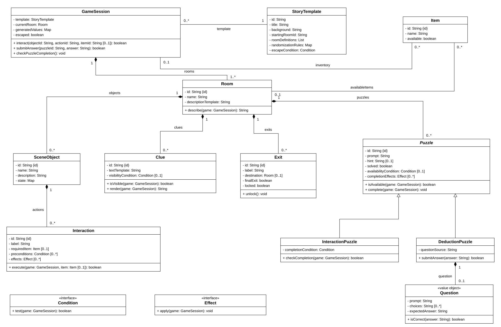
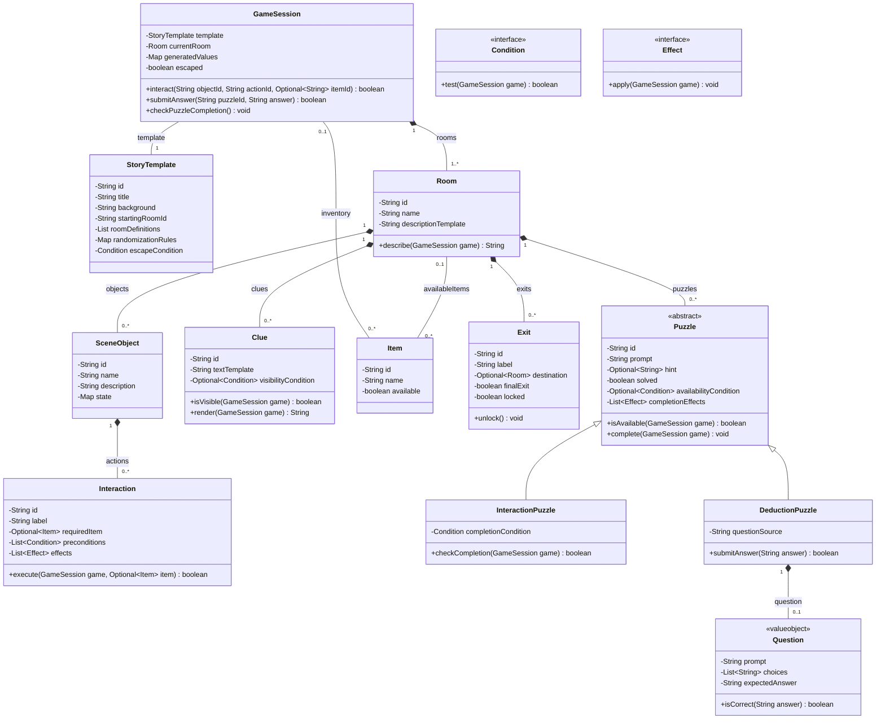
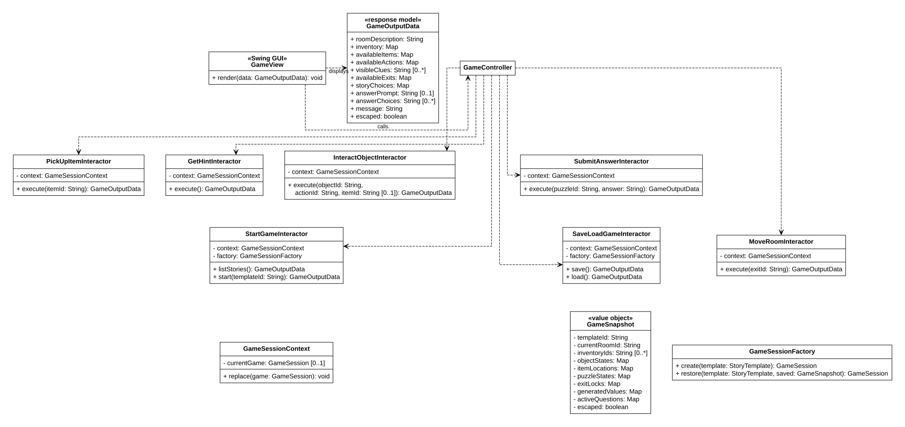
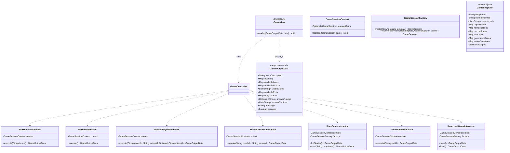
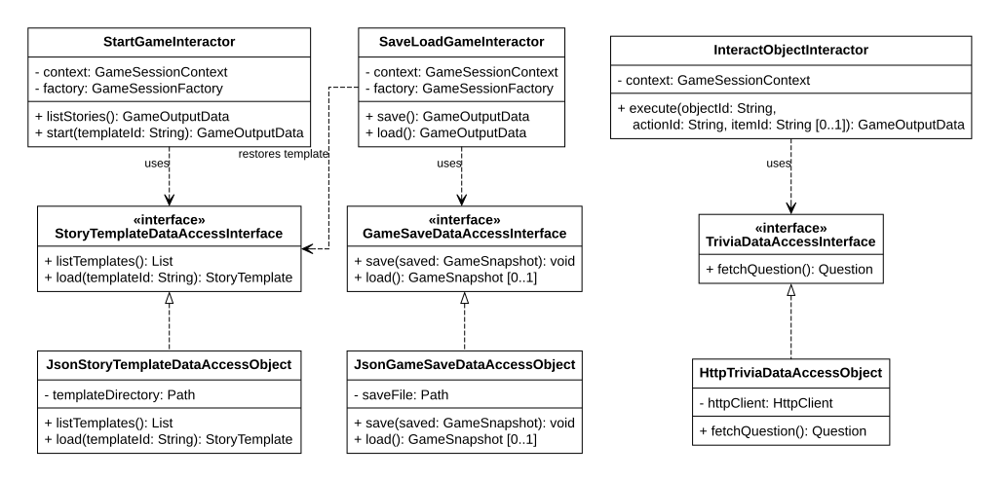

### Escape Room Adventure UML

Proposed design for a Java Swing escape-room game driven by JSON story templates. The team still needs to confirm the template schema, external trivia provider, and game-save implementation. Local JSON game saves are the current proposal.

#### Story, world, and puzzle classes

`StoryTemplate` is immutable story configuration. Its room definitions describe connections, objects, item placement, clues, actions, puzzles, hints, randomization rules, and escape conditions. `GameSessionFactory.create` instantiates a new mutable world for each session. Runtime rooms and object states are independent of the template and of other sessions. The diagrams summarize configuration lists and maps while the JSON schema is under discussion.

`SceneObject` represents an object such as a light switch or drawer. Its `Interaction` actions have preconditions, an optional required item, and effects. Clicking a switch can execute an action with no item. Using a screwdriver supplies an item to the selected cover-opening action. The game validates current-room access, action availability, and item possession before applying the effects.

The abstract `Puzzle` provides common availability checks, hints, solved state, and completion effects. `InteractionPuzzle` completes when its environment condition becomes true. `DeductionPuzzle` accepts a numeric code, text, or selected answer through a `Question`. Puzzle completion effects apply once, so repeated submissions do not recreate rewards. A room can contain both types. `Condition` and `Effect` are interfaces for configured game rules. Example implementations check an object's state, reveal an item, or unlock an exit.

An item moves from its room to the inventory when collected. It cannot be held in both places. Hidden items are excluded from the available item list until the appropriate effect reveals them. A clue's visibility is determined from the current state. Its displayed text resolves any generated-value references against the active session.

For an exit leading to another room, `destination` refers to that room. A configured final exit can have no destination. Taking it checks the template's escape condition before setting the session's escaped status.

#### Swing and application classes

`GameView` presents room text, visible clues, item and inventory lists, operation buttons, and an answer field or choices. It delegates player actions through `GameController`. Interactors return `GameOutputData`, which contains plain strings, labels, identifiers, and choices for Swing to render. The output maps pair IDs with display labels. The UI refreshes the description, available items, actions, exits, and completion status after a state change.

The five user stories remain player goals. Their application work can use several focused interactors.

| User Story | Interactors |
|------------|-------------|
| 1. Pick Up Items | `PickUpItemInteractor` |
| 2. Get Hints | `GetHintInteractor` |
| 3. Interact with Objects and Solve Puzzles | `InteractObjectInteractor`, `SubmitAnswerInteractor` |
| 4. Choose a Story and Explore Rooms | `StartGameInteractor`, `MoveRoomInteractor` |
| 5. Save and Load Game Progress | `SaveLoadGameInteractor` |

These groupings describe program responsibilities. The five member work-split sections remain for the team to fill in.

All interactors share `GameSessionContext`. Starting a new game or loading a save replaces its active session only after the candidate session is successfully created and validated. Later actions then use that active session. `GameSessionFactory.create` generates configured values once when starting a new game. `restore` applies the saved values and runtime state when resuming a game.

`GameSnapshot` records the selected template ID, current room, inventory, item locations and availability, scene-object states, solved puzzles, exit locks, generated values, retrieved questions and answers, and escape status. Clue visibility is recovered from the restored environment and puzzle state.

#### Template, trivia, and save data access

The use cases own `StoryTemplateDataAccessInterface`, `TriviaDataAccessInterface`, and `GameSaveDataAccessInterface`. The JSON and HTTP adapters implement those interfaces. Game rules and use cases therefore depend on their own abstractions, and the concrete adapters can be replaced when testing. Each interactor addresses one application goal, while entity classes implement the reusable game rules.

The main menu lists templates through `StoryTemplateDataAccessInterface`. Starting a game loads the selected template and instantiates its rooms and configured rules. The template ID is stored in a save so loading can restore the appropriate story.

Only puzzles configured to use external questions call `TriviaDataAccessInterface`. When such a puzzle is activated and has no question yet, the HTTP adapter obtains a question. The interactor stores it on the active puzzle. Repeated attempts and save/load use that same question. A failed request produces a message and permits a retry. Environment actions and template-defined deduction answers are evaluated from the configured rules and session state.

Saving captures a snapshot. Loading reads the snapshot, loads its referenced template, validates IDs and required state, and restores the candidate session using the saved generated values and questions. The active session is replaced after restoration succeeds. A missing or invalid save, unavailable template, or read/write failure produces an explanatory message. The JSON save adapter can write a temporary file and replace the previous save after a successful write.

```mermaid
classDiagram
    direction TB
    class StartGameInteractor {
        -GameSessionContext context
        -GameSessionFactory factory
        +listStories() GameOutputData
        +start(String templateId) GameOutputData
    }
    class InteractObjectInteractor {
        -GameSessionContext context
        +execute(String objectId, String actionId, Optional~String~ itemId) GameOutputData
    }
    class SaveLoadGameInteractor {
        -GameSessionContext context
        -GameSessionFactory factory
        +save() GameOutputData
        +load() GameOutputData
    }
    class StoryTemplateDataAccessInterface {
        <<interface>>
        +listTemplates() List
        +load(String templateId) StoryTemplate
    }
    class TriviaDataAccessInterface {
        <<interface>>
        +fetchQuestion() Question
    }
    class GameSaveDataAccessInterface {
        <<interface>>
        +save(GameSnapshot saved) void
        +load() Optional~GameSnapshot~
    }
    class JsonStoryTemplateDataAccessObject {
        -Path templateDirectory
        +listTemplates() List
        +load(String templateId) StoryTemplate
    }
    class HttpTriviaDataAccessObject {
        -HttpClient httpClient
        +fetchQuestion() Question
    }
    class JsonGameSaveDataAccessObject {
        -Path saveFile
        +save(GameSnapshot saved) void
        +load() Optional~GameSnapshot~
    }
    StartGameInteractor ..> StoryTemplateDataAccessInterface : uses
    InteractObjectInteractor ..> TriviaDataAccessInterface : uses
    SaveLoadGameInteractor ..> GameSaveDataAccessInterface : uses
    SaveLoadGameInteractor ..> StoryTemplateDataAccessInterface : restores template
    JsonStoryTemplateDataAccessObject ..|> StoryTemplateDataAccessInterface
    HttpTriviaDataAccessObject ..|> TriviaDataAccessInterface
    JsonGameSaveDataAccessObject ..|> GameSaveDataAccessInterface
```

#### Example state progression

1. The player chooses the Abandoned Laboratory template. The factory creates its runtime rooms and generates any configured values for the wall numbers and drawer code.
2. The player selects the switch's turn-on interaction with no inventory item. Its effect changes the light's state. An environmental puzzle can now meet its completion condition, and the wall clue becomes visible.
3. Swing refreshes the room description and displays the wall clue with this session's generated numbers. The note supplies the ordering needed to infer the code.
4. The player submits the code to the drawer's deduction puzzle. The answer is checked against the expected answer instantiated from those same values.
5. Correct completion opens the drawer or changes its state and reveals the key. The item becomes available to pick up.
6. The player collects the key and supplies it to the door's unlock interaction, then moves through the unlocked exit.
7. Saving at any stage captures the state reached so far. Loading restores the same generated numbers, answer, object states, and item locations.
